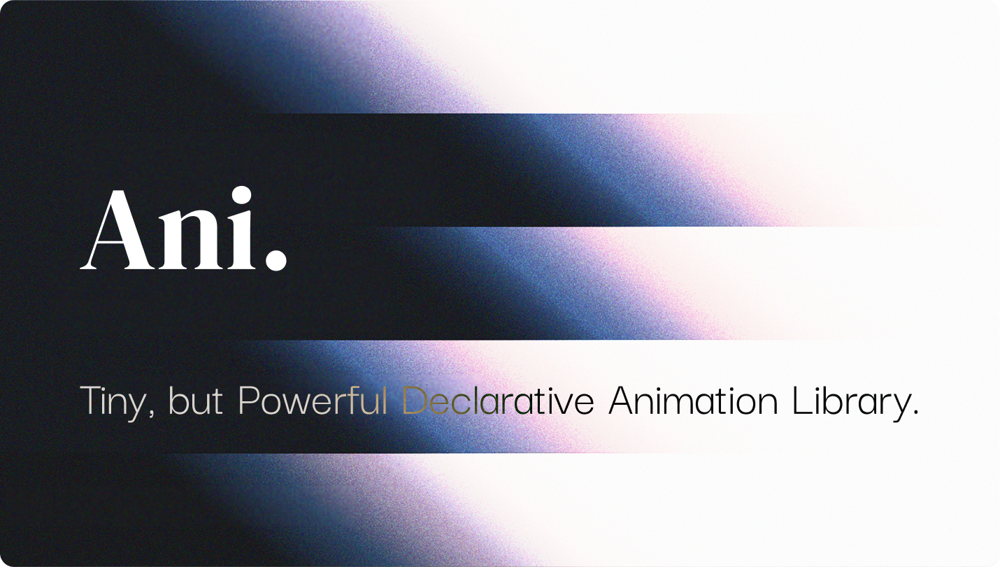

# freestyle/ani



Ani is a declarative animation library. You describe an animation once as an immutable tree, and a timeline plays it on any element, in plain TypeScript or with the React, Vue, Solid and Svelte bindings.

## Packages

| Package | Purpose |
| :--- | :--- |
| `@freestylejs/ani-core` | The engine: animation nodes, timelines, clock. |
| `@freestylejs/ani-react` | React hooks. |
| `@freestylejs/ani-vue` | Vue composables. |
| `@freestylejs/ani-solid` | Solid primitives. |
| `@freestylejs/ani-svelte` | Svelte actions and stores. |
| `@freestylejs/ani-codemod` | Migrates ANI 1.x code to ANI 2. |

## Quick start

```sh
npm install @freestylejs/ani-core
```

```ts
import * as a from '@freestylejs/ani-core'

// 1. Describe the animation. Every duration is in seconds.
const reveal = a.parallel([
    a.ani({ to: { opacity: 1 }, duration: 0.3 }),
    a.ani({ to: { translateY: 0 }, duration: 0.4 }),
])

// 2. Create a timeline and bind it to an element.
const timeline = a.rafTimeline(reveal)
const card = document.createElement('div')
const unbind = timeline.bind(card)

// 3. Play it. The promise never rejects.
timeline.play({ from: { opacity: 0, translateY: 16 } }).then((result) => {
    // result is 'ended', 'interrupted', 'skipped', 'reset' or 'disposed'
    unbind()
    timeline.dispose()
})
```

Animations honor `prefers-reduced-motion` by default: the timeline jumps to its end state. Pass `{ reducedMotion: 'ignore' }` to `rafTimeline` for essential motion.

## Documentation

Visit [ani](https://freestyle-ani.vercel.app/en) to read the documentation.

## Upgrading from 1.x

ANI 2.0 removes the 1.x API and measures every delay in seconds. Run the codemod once on your 1.x code (commit before you do), read every warning it prints, then follow the [migration guide](https://freestyle-ani.vercel.app/en/docs/guides/migration-v2).

```sh
npx @freestylejs/ani-codemod src
```

## Contributing

Please read [contributing guide](./CONTRIBUTING.md).

## License

Licensed under the [MIT](./LICENSE.md) License.  
